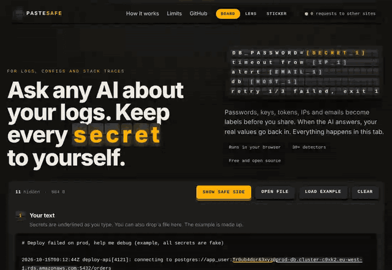

# Paste-Safe

[](https://sandeepkomal.github.io/paste-safe/)
[](https://github.com/SandeepKomal/paste-safe/actions/workflows/ci.yml)
[](https://github.com/SandeepKomal/paste-safe/actions/workflows/codeql.yml)
[](https://github.com/SandeepKomal/paste-safe/actions/workflows/pages.yml)
[](https://github.com/SandeepKomal/paste-safe/releases)
[](LICENSE)
[](#privacy)
[](#install-it-or-use-it-offline)

Strip secrets out of logs and configs before pasting them into ChatGPT, Claude or whatever AI you use, then put the real values back into its answer.

**Use it now: https://sandeepkomal.github.io/paste-safe/** (free, no sign-up, nothing to install)



| Board | Lens | Sticker |
| --- | --- | --- |
|  |  |  |

## Usage

1. Paste a log, config or stack trace. Anything that looks secret gets underlined.
2. Copy the safe version. Secrets become labels like `[AWS_KEY_1]`; the same value always gets the same label.
3. Paste the AI's reply into the bottom box and the labels turn back into your values.

You can switch individual findings off if they're fine to share. Hovering a label shows the value behind it.

You can also open or drop a file (`.log`, `.env`, `.yaml`, `.json` and other text files up to 50 MB). Large files are checked in a background worker so the page doesn't freeze.

By default, copying adds one line on top asking the AI to keep labels like `[IP_1]` as they are. If the AI still changes them a little (`IP_1`, `[ip-1]`), they're put back anyway.

There are three themes (switch in the header, or open `#board`, `#lens` or `#sticker`). Board is the default: labels are drawn as split-flap tiles and the workbench turns over, with your text on the front and the safe text on the back.

## What gets hidden

- Keys and tokens: AWS, Azure, Google Cloud, GitHub, GitLab, npm, Slack, Stripe, SendGrid, Twilio, Shopify, Hugging Face, Discord, Google, OpenAI/Anthropic, JWTs, private key blocks
- Auth headers and logins: bearer tokens, `Authorization: Basic`, Docker registry logins, session cookies, tokens in URLs (`?access_token=`, signed S3/GCS links)
- Passwords in connection URLs and in settings like `DB_PASSWORD=`, `client_secret:`, `api_key=`
- Personal details: emails, phone numbers, payment card numbers (Luhn-checked), usernames in paths like `/home/jane` or `C:\Users\jane`
- Network details: IPv4 and IPv6 addresses, MAC addresses, internal/cloud hostnames
- Your own words, such as a company or server name (set under Findings, saved in your browser only)
- Long random-looking strings that none of the above matched

Things like `localhost`, commit hashes, UUIDs, file paths and `${VAR}` references are left alone.

Detection is pattern-based, so it can miss things. Check the output before you paste it anywhere.

## Privacy

Everything runs in your browser. There's no backend, no analytics and no account.

- The page's security policy (`connect-src 'none'`) stops it from sending data anywhere, and the header shows a live count of requests to other sites. It should stay at 0.
- Your text and the labels are never saved. Close or reload the tab and they're gone.
- Only your settings are kept in your browser: the theme, your own words list, and whether copy adds the note.
- The offline cache holds only the site's own files.

## Install it or use it offline

After your first visit, Paste-Safe works with no internet connection. In Chrome or Edge, use **Install** in the address bar (or the menu); on iPhone, **Share → Add to Home Screen**. It then opens like an app.

## Browser support

Current Chrome, Edge, Firefox and Safari (16.4 or newer), on desktop and mobile.

## FAQ

**Is it safe to paste real secrets into this page?** The page can't send them anywhere, and you can check: the request counter, the CSP in `index.html`, and the source code are all public. Still, treat it like any tool: use it on a device you trust, and check the safe text before you share it.

**Can I run it on my own server?** Yes. It's static files: serve the repository folder with any web server, or fork it and turn on GitHub Pages (see below).

**It missed a secret, or hid something harmless.** Please [open an issue](https://github.com/SandeepKomal/paste-safe/issues/new/choose) with a made-up example in the same format. Never post a real secret.

## Development

Node 22 and Python 3. No build step.

```bash
npm ci
npm start              # localhost:8080
npm run check          # eslint + tsc + unit tests
npx playwright install chromium
npm run test:e2e
```

See [CONTRIBUTING.md](CONTRIBUTING.md) for how to add a detector. Detection lives in `src/core/` (no DOM, tested in Node). UI code is in `src/ui/`, wired together in `src/main.js`. Types are in `types/index.d.ts`.

To host a fork, enable **Settings → Pages → Source: GitHub Actions** and push to `main`.

## Security

Found a way to make the page leak data? Please report it privately, see [SECURITY.md](SECURITY.md).

## License

MIT, see [LICENSE](LICENSE). No third-party code, fonts or images are shipped; the site uses system fonts. Please follow the [code of conduct](CODE_OF_CONDUCT.md).
