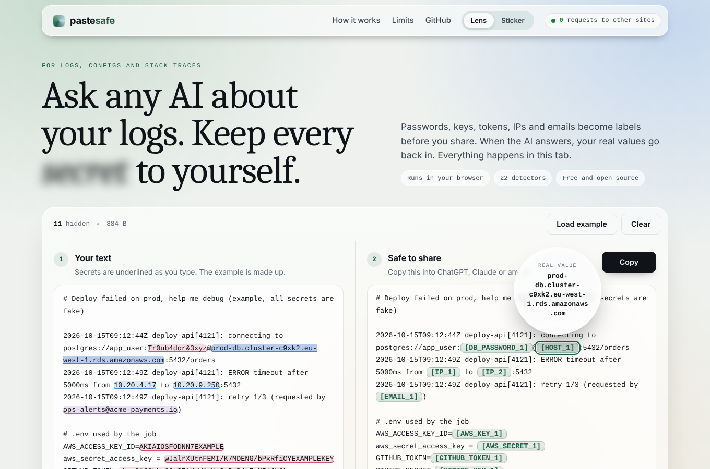
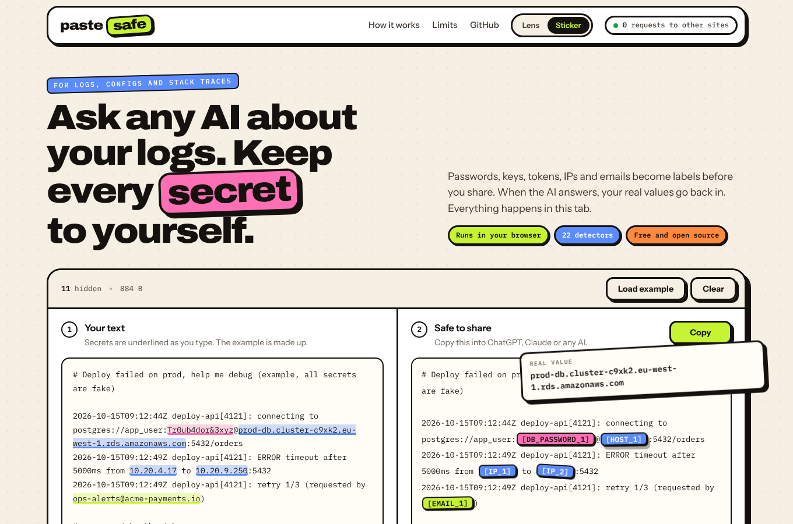

# Paste-Safe

[](https://github.com/SandeepKomal/paste-safe/actions/workflows/ci.yml)

Strip secrets out of logs and configs before pasting them into ChatGPT, Claude or whatever AI you use, then put the real values back into its answer.

https://sandeepkomal.github.io/paste-safe/

| Lens | Sticker | Holo |
| --- | --- | --- |
|  |  |  |

## Usage

1. Paste a log, config or stack trace. Anything that looks secret gets underlined.
2. Copy the safe version. Secrets become labels like `[AWS_KEY_1]`; the same value always gets the same label.
3. Paste the AI's reply into the bottom box and the labels turn back into your values.

You can switch individual findings off if they're fine to share. Hovering a label shows the value behind it.

There are three themes (switch in the header, or open `#lens`, `#sticker` or `#holo`).

## What gets hidden

- Keys and tokens: AWS, Azure, GitHub, GitLab, npm, Slack, Stripe, SendGrid, Google, OpenAI/Anthropic, JWTs, bearer tokens, private key blocks
- Passwords in connection URLs and in settings like `DB_PASSWORD=`, `client_secret:`, `api_key=`
- Emails, IP addresses, internal/cloud hostnames
- Long random-looking strings that none of the above matched

Things like `localhost`, commit hashes, UUIDs, file paths and `${VAR}` references are left alone.

Detection is pattern-based, so it can miss things. Check the output before you paste it anywhere.

## Privacy

Everything runs in the browser. There's no backend and nothing is stored. The page's CSP has `connect-src 'none'`, and the header shows a live count of requests to other sites (it should stay at 0).

## Development

Node 22 and Python 3. No build step.

```bash
npm ci
npm start              # localhost:8080
npm run check          # eslint + tsc + unit tests
npx playwright install chromium
npm run test:e2e
```

Detection lives in `src/core/` (no DOM, tested in Node). UI code is in `src/ui/`, wired together in `src/main.js`. Types are in `types/index.d.ts`.

To host a fork, enable **Settings → Pages → Source: GitHub Actions** and push to `main`.

## License

MIT. No third-party code, fonts or images are shipped; the site uses system fonts.
